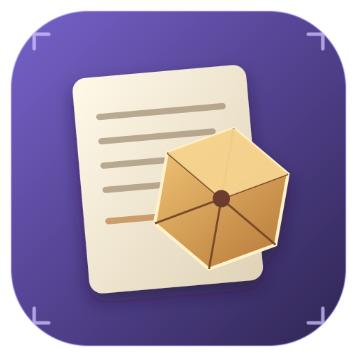

<div align="center">



# Codex — D&D character sheets

### D&D 5e CHARACTER SHEETS · WINDOWS · LINUX · ANDROID


**A local application for keeping visual Dungeons & Dragons 5e character sheets.**

Current version `1.0.0`. Data stays on your device: no accounts, no server,
no network requests.

Product page: [fworkslab.github.io/products/codex](https://fworkslab.github.io/products/codex/index.en.html)

[Русский](README.md)

</div>

---


## Features

- two working modes: individual sheets and a shared table with several sheets;
- profiles and sessions with local storage;
- D&D 5e rules editions 2014 and 2024;
- full and compact sheet templates;
- built-in help `?` on every parameter;
- dark and light themes;
- Russian and English interface;
- automatic saving to local storage;
- export of an open sheet to PDF: the system print dialog on desktop, Share/PDF on Android;
- a table with panning, zooming, dragging sheets and adding them at the edges;
- touch control on the table: drag, pinch-zoom, tap to open a sheet;
- a hideable table panel on Android with landscape orientation locked;
- localized standard Electron menu;
- an installer that asks for language, folder and shortcuts, then shows a parameter check screen.

## Download

Ready-made files are in **[Releases](../../releases)**. Download the one for your platform and run it.

| Platform | File | Size |
|---|---|---|
| Windows | `DND-Character-Sheets-Setup-1.0.0.exe` | 127.5 MB |
| Linux | `DND-Character-Sheets-1.0.0.AppImage` | 129.8 MB |
| Linux | `DND-Character-Sheets-1.0.0.deb` | 88.5 MB |
| Android | `DND-Character-Sheets-1.0.0.apk` | 3.5 MB |
| Android | `DND-Character-Sheets-1.0.0.aab` | 3.4 MB |

**Windows.** Download the `.exe` and run it. The installer asks for language, folder and shortcuts, then shows a verification screen.

**Linux, AppImage.** No installation needed. GitHub does not preserve the execute bit for downloaded files, so run this once:

```bash
chmod +x DND-Character-Sheets-1.0.0.AppImage
./DND-Character-Sheets-1.0.0.AppImage
```

**Linux, deb.** For Debian-based distributions and Ubuntu derivatives:

```bash
sudo apt install ./DND-Character-Sheets-1.0.0.deb
```

**Android.** Download the `.apk`, allow installation from this source in Android settings, and open the file. The app is signed with a permanent key, so every future version updates the one you already installed.

Both Linux files are built automatically on a free GitHub Actions Linux runner — the workflow `.github/workflows/release-linux.yml` builds the `.AppImage` and `.deb` when a `v*` tag appears and attaches them to the release.

## Screenshots

| | | |
|---|---|---|
|  |  | |
| **Start screen** — entry without an account | **Mode selection** — personal table or shared table | |
|  |  | |
| **Profiles** — your own or shared | **Creating a session** — for play or for rules editing | |
|  |  | |
| **Shared table** — sheets drag, the table pans and zooms | **Character sheet** — help `?` on every field | |

## License

Apache-2.0. Full text is in [LICENSE](LICENSE). The code may be modified and used in your own projects provided you keep the attribution notice.

## Privacy

The application works locally: sheet, profile and session data are stored in the application profile and never sent anywhere. System backup is disabled in AndroidManifest, and the WebView permission is used only by Capacitor's internal runtime; the application makes no network requests.

Limitation on sync: in “everyone has their own device” mode, separate devices do not sync with each other — this is a local-first application with no server.